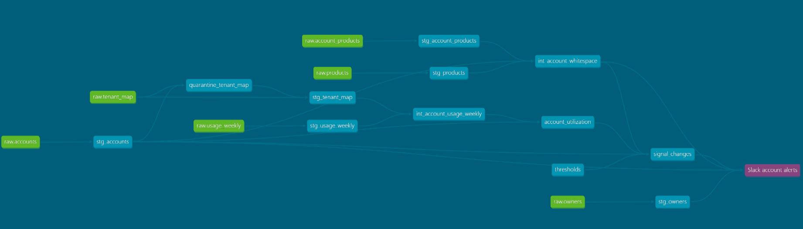

# Account Signals: usage-drop and expansion alerts (prototype)

A small retention system for a B2B SaaS company. Every week it compares each customer's product usage with the week before, finds accounts whose usage is **collapsing** (churn risk) or **near seat capacity with products left to buy** (expansion chance), and sends each alert **once** to the right owner in Slack.

> Working prototype / reference design. All companies, people and numbers are synthetic.


## Where it sits in the revenue chain

After the sale: **usage → renewal → expansion**. It turns product usage, which lives in the product and is keyed by *tenant*, into account-level actions for the CSM (protect the renewal) and the AE (grow the account).

## Architecture

```
data/*.csv ─► load_raw.py ─► DuckDB  raw schema (untouched exports)
                               │
                               ▼  dbt
       staging       clean types, one source each, quarantine bad mappings
       intermediate  tenant-week ─► account-week · whitespace per account
       marts         account_utilization ─► signal_changes (rules from seeds/thresholds.csv)
                               │
                               ▼
       FastAPI  /signals/sync · /signals/pending · /signals/delivered · /signals/log
                │ picks the owner (RevOps fallback), writes the message,
                │ logs each signal once in SQLite
                ▼
       n8n  Schedule (Mon 09:00) ─► Sync ─► Get pending ─► Slack ─► Mark delivered
```




| Part | Job | Tool |
|---|---|---|
| Warehouse | Holds raw exports and modelled tables | DuckDB (runs the same dbt models on Snowflake by changing the profile) |
| Brain | Cleans, joins, re-grains, applies the rules | dbt (13 models, 1 seed, 1 exposure) |
| Rulebook | Thresholds, editable without code | `seeds/thresholds.csv` |
| Clerk | Routing, message text, send-once logbook | FastAPI + SQLite |
| Carrier | Runs weekly, moves alerts, confirms delivery | n8n |
| Mailbox | Where owners see alerts | Slack |

## The rules

| Signal | Fires when (all must be true) | Goes to |
|---|---|---|
| `usage_drop` | weekly active users fell **30% or more** vs last week | the account's CSM |
| `expansion` | utilization (active users ÷ seats) is **0.70 or more** **and** at least **1 product** not owned yet | the account's AE |

No CSM or AE on the account → the alert goes to **RevOps**, so nothing falls on the floor.

## Design decisions

- **Raw stays raw.** Exports land untouched in a `raw` schema with a load timestamp; all fixing happens in dbt, so you can always go back to what arrived.
- **Quarantine instead of crash.** Tenant mappings that point to a missing or empty account are set aside in `quarantine_tenant_map` with a reason. Raw-layer tests *warn*; the same checks on the clean layer *fail the build*. Two bad rows don't block alerts for 20 accounts, and RevOps gets a fix list.
- **Exact duplicates removed, conflicting ones stop the build.** Picking one of two different numbers would be guessing.
- **Re-grain in its own model.** `int_account_usage_weekly` turns tenant-weeks into account-weeks, so a customer with two workspaces is judged as one account (one workspace dropping 70% inside a stable account is not an alert).
- **"Utilization", not "health".** Active users ÷ seats is what the number really measures; the name doesn't promise more.
- **Honest unknowns.** No baseline or a zero baseline gives `NULL` with a reason, never a fake −100% or infinite growth. A rule on an unknown value never fires.
- **Rules are data.** Thresholds live in a CSV that dbt loads as a seed and tests (allowed metrics, operators, roles), so a typo can't silently disable a rule.
- **No upsell during a fall.** An expansion signal on an account that also has a usage drop is kept for audit but **suppressed**, not sent.
- **Detection is separate from delivery.** dbt records every signal; FastAPI decides who gets it and whether it goes out.
- **Send once.** Each signal has a key `account|signal|week`. The logbook inserts it only once; running the workflow again sends nothing new.
- **Receipt after delivery.** An alert is marked delivered only after Slack accepts it. If Slack fails, it stays pending and goes out on the next run.
- **The warehouse is opened read-only, per request,** so the API never blocks `dbt build`.

## Proof it works

| Check | Result |
|---|---|
| `dbt build` | 68 nodes, 0 errors. 50 data tests + 1 unit test pass; the 3 warnings are the planted raw-data traps, caught on purpose |
| `tests/answer_key_accounts_match.sql` | all 20 accounts match the answer key (users, change, whitespace, signals) |
| `check_routing.py` | 7 of 7 signals assigned to the expected person, including the RevOps fallback and the suppressed expansion |
| Second workflow run | Sync logs 0 new, Get pending returns nothing, no Slack messages |

### Planted test cases

| Account | What it tests | Expected |
|---|---|---|
| ACC-008 | Usage halves before renewal while the vendor health score is still high | usage_drop |
| ACC-009 | Exactly −30.0% (boundary), calculated from raw users | usage_drop |
| ACC-010 | −29% (just under the boundary) | none |
| ACC-011 | Usage drop with no CSM assigned | usage_drop → RevOps |
| ACC-012 | Over-seat usage that is falling: both rules match | usage_drop sent, expansion suppressed |
| ACC-013 | High utilization, 2 products not owned | expansion |
| ACC-014 | Utilization exactly 0.70 (boundary) | expansion |
| ACC-015 | Utilization 0.69 (just under) | none |
| ACC-016 | High utilization but owns every product | none |
| ACC-017 | Two tenants: one drops 70%, the account drops 20% | none |
| ACC-018 | Duplicate usage row would fake a −52.5% drop | none |
| ACC-019 | Persistently low but stable usage | none (known rule gap) |
| ACC-020 | +50% growth, still below 0.70 | none |
| T-5022 / T-5023 | Mapping to a typo'd account / an empty account | quarantined, excluded |

## Run it locally (Windows)

```
python -m venv .venv
.venv\Scripts\activate
pip install -r requirements.txt

python load_raw.py                 # CSVs → DuckDB raw schema
dbt build                          # models + all tests
uvicorn main:app --reload          # API on http://127.0.0.1:8000 (docs at /docs)
python check_routing.py            # after POST /signals/sync
```

n8n: `npm install -g n8n`, then `n8n start`, import `n8n/account-signals-flow.json`, add a Slack bot credential (scope `chat:write`), invite the bot to your channel, and set your channel ID in the Slack node. To skip the answer-key test on other data: `dbt build --exclude tag:answer_key`.

## Honest limits

- **Synthetic data proves the logic, not the business result.** A customer who logs in again after an alert isn't proof the alert saved them.
- **Breadth, not depth.** Weekly active users counts *people*, not how intensively they use the product.
- **Rules catch change, not level.** An account that is steadily low (ACC-019) never alerts.
- **The 30% and 0.70 lines are judgment calls.** A better version would set them from each account's normal week-to-week variation (control limits).
- **At-least-once delivery.** If Slack accepts a message but the receipt call fails, the next run sends it again. Twice is better than never.
- **Adding tenants assumes different people** in each workspace; one person active in both would be counted twice.
- **Local only.** The schedule runs only while n8n is running; Slack handles are text, not real mentions.

## Roadmap

1. **v0.2 cases:** one open case per account and issue, approve or dismiss, and an outcome check a few weeks later (detect → decide → act → check).
2. **AI brief:** add the ChurnZero score and recent Gong call summaries (already modelled in staging) to each alert.
3. **Freshness guard:** don't alert on stale data (`_loaded_at` is already stamped on every raw row).
4. **Thresholds from data:** control limits per segment instead of fixed lines.
5. **Production:** hosted API and n8n, PostgreSQL logbook, Slack DMs to real user IDs, monitoring.

## Data

Built from the requirements of a real job posting for a customer-retention engineering role (training software for property managers). Every account, person, call and number is invented.
